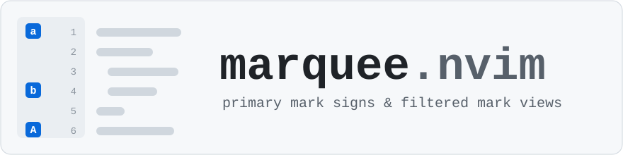

# marquee.nvim



A Neovim plugin for primary marks: the letter marks `a-z` (buffer local) and `A-Z` (global/file marks).

- Shows primary marks as signs in the gutter.
- Filters the `telescope.nvim` and `which-key.nvim` mark views to primary marks.
- Deletes a mark, the marks on a line, the marks in a buffer, or all of them.

It keeps the native `m`, `'` and `` ` `` workflow and stays out of the way otherwise.


## Requirements

- Neovim 0.9+ (0.12+ for `vim.pack`)
- [telescope.nvim](https://github.com/nvim-telescope/telescope.nvim) and [which-key.nvim](https://github.com/folke/which-key.nvim) v3+ (optional)

## Installation

With `vim.pack`:

```lua
vim.pack.add {
  'https://github.com/jmachadofreitas/marquee.nvim',
  -- Optional integrations:
  'https://github.com/folke/which-key.nvim',
  'https://github.com/nvim-telescope/telescope.nvim',
  'https://github.com/nvim-lua/plenary.nvim', -- needed by telescope.nvim
}
require('marquee').setup()
```

With [lazy.nvim](https://github.com/folke/lazy.nvim):

```lua
{
  'jmachadofreitas/marquee.nvim',
  event = 'VeryLazy',
  dependencies = {
    -- Optional integrations:
    'folke/which-key.nvim',
    { 'nvim-telescope/telescope.nvim', dependencies = { 'nvim-lua/plenary.nvim' } },
  },
  opts = {},
}
```

Both integrations are optional: leave out the ones you don't use. which-key.nvim has to be available when `setup()` runs, so add it first; otherwise its integration is skipped. `:checkhealth marquee` reports whether it is active.

## Configuration

Defaults:

```lua
require('marquee').setup {
  sign_group = 'marquee-signs',
  sign_priority = 10,
  signs = true,
  keymaps = true,
  which_key = true,
  mappings = {
    set = 'm',
    delete = 'dm',
    clear_buffer = 'dm|',
    telescope = '<leader>mm',
    clear_all = 'dM',
    toggle_signs = '<leader>ms',
    refresh = '<leader>mr',
  },
  display = {
    telescope = 'primary', -- or 'all'
    which_key = 'primary', -- or 'all'
  },
}
```

Set a mapping to `false` to disable it, or `keymaps = false` to disable all of them.

## Usage

Keymaps:

- `m{char}`: set a mark
- `dm{char}`: delete a primary mark
- `dm-` or `dm<Space>`: delete primary marks on the current line
- `dm|`: delete local primary marks in the current buffer
- `dM`: delete all primary marks
- `<leader>mm`: open the marks picker
- `<leader>ms`: toggle signs
- `<leader>mr`: refresh signs

Commands:

- `:MarqueeRefresh`
- `:MarqueeToggleSigns [bufnr]`
- `:MarqueeTelescope`
- `:MarqueeClear`
- `:MarqueeClearBuffer`
- `:MarqueeDelete [mark]`
- `:MarqueeDeleteLine`

With `display.which_key = 'primary'`, `'` and `` ` `` list only primary marks. `<Space>'` and ``<Space>` `` open which-key's default popup. With `display.telescope = 'primary'`, the picker lists only primary marks. Without Telescope, it falls back to `:marks`.

Signs use the `MarqueeSign` and `MarqueeSignNum` highlight groups. They link to `DiagnosticHint` by default.

See `:help marquee` for the full reference, including the Lua API, and `:checkhealth marquee` to check your setup.

## Limitations

- Native `:delmarks` is not intercepted.
- Marks changed outside marquee show up on the next `BufEnter` or after `:MarqueeRefresh`.

## Development

```sh
for spec in tests/*_spec.lua; do nvim --headless --clean -l "$spec" || break; done   # tests
stylua --check .                                                                    # formatting
vhs assets/demo.tape                                                                # regenerate the demo GIF
```

## License

MIT
